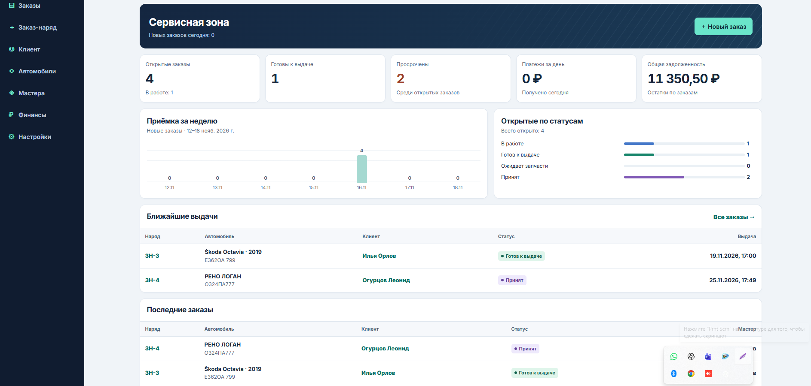
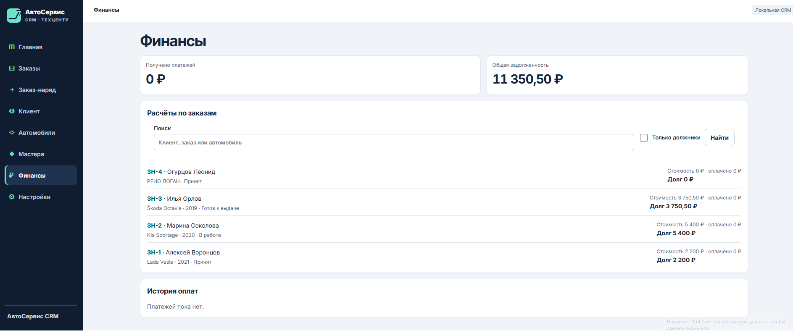

<h1 align="center">🔧 АвтоСервис CRM</h1>

<p align="center"><strong>Приёмка автомобилей, заказ-наряды и оплаты в одном рабочем окне.</strong></p>

<p align="center">
  
  
  
</p>

---

## 🧠 О проекте

**«АвтоСервис CRM»** — локальное веб-приложение для небольшого автосервиса. Оно связывает клиентов, автомобили, мастеров, заказ-наряды и платежи, чтобы сотрудники могли видеть состояние ремонта и расчётов с заказчиком.

CRM открывается в браузере, сервер запускается на компьютере, а данные сохраняются в SQLite. Для запуска требуется Node.js 24 или новее.

---

## 🎯 Какую задачу решает

При работе автосервиса важно быстро найти клиента и автомобиль, зафиксировать обращение, составить смету и согласовать срок выдачи. По мере ремонта меняются статусы, добавляются работы и поступают оплаты.

CRM хранит эту информацию в связанных карточках. На главной видно, какие заказы открыты, какие готовы к выдаче, где нарушен срок и сколько денег ещё должны клиенты.

~~~
Клиент и автомобиль → приёмка → работы и запчасти → ремонт → оплата и выдача
~~~

---

## 👤 Для кого

| Пользователь | Как использует CRM |
| --- | --- |
| **Мастер-приёмщик** | Создаёт заказ-наряд, фиксирует обращение, назначает мастера и обещанное время выдачи. |
| **Владелец или руководитель автосервиса** | Смотрит оперативные показатели, просроченные заказы, поступившие платежи и задолженность. |
| **Сотрудник, который ведёт расчёты** | Вносит предоплату и последующие платежи, проверяет оплаченные суммы и остатки по заказам. |

---

## 🛠️ Возможности

### 📊 Главная

Открытые, готовые и просроченные заказы, приёмка за семь дней, платежи за день, общий долг, ближайшие выдачи и последние заказ-наряды.

### 🚗 Клиенты, автомобили и мастера

Карточки клиентов с контактами, связанными автомобилями и историей заказов. Справочники автомобилей и мастеров помогают выбрать существующую запись при оформлении наряда.

### 📋 Заказ-наряды

Обращение клиента, мастер-приёмщик, срок выдачи, работы и запчасти в смете. Поиск и фильтр по статусу помогают найти нужный заказ. Переходы между статусами фиксируются в истории.

### 💳 Оплаты и задолженность

Предоплата и последующие частичные платежи привязаны к заказу. CRM рассчитывает полученную сумму и долг, проверяет переплату. Финансовый раздел показывает сметы, оплаты и задолженность.

### 💾 Настройки и резервные копии

Реквизиты автосервиса, скачивание SQLite-копии и восстановление с предварительной проверкой файла. Перед восстановлением сохраняется снимок текущей базы.

---

## ⚙️ Технологии

| Часть проекта | Реализация |
| --- | --- |
| Интерфейс | HTML, CSS, браузерный JavaScript |
| Сервер | Node.js 24, JavaScript ES modules |
| Хранение данных | SQLite и SQL-миграции |
| Проверки | Встроенный тестовый модуль Node.js, проверка синтаксиса JavaScript |

Устанавливать npm-пакеты для запуска не требуется. По умолчанию сервер доступен на локальном адресе компьютера.

---
Локальная CRM для небольшого автосервиса. Заказ-наряды, клиенты, справочники автомобилей и мастеров, платежи, настройки и аналитика работают с SQLite.

## Запуск

Дважды щёлкните по файлу «Запустить АвтоСервис CRM.cmd». Он запустит сервер в фоне и откроет CRM в браузере по умолчанию. Повторный запуск открывает уже работающую CRM. Если сервер не стартует, подробности будут в `data/server-error.log`.

Для запуска нужен Node.js 24 или новее. Устанавливать пакеты не требуется. Для ручного запуска откройте терминал в корне репозитория и выполните:

```powershell
npm.cmd start
```

Откройте [CRM](http://127.0.0.1:4178/). [Проверка запуска](http://127.0.0.1:4178/health) возвращает HTTP 200, когда сервер читает БД. При первом старте создаётся `data/autoservice.sqlite`. Перед обновлением схемы сохраняется `*.before-migration-*.sqlite` рядом с рабочей базой. При ручном запуске сервер останавливается по Ctrl+C.

Для начала работы создайте клиента, автомобиль и активного мастера. Затем из раздела «Заказы» оформите наряд, укажите работы или запчасти и сохраните. Откройте сохранённый заказ, чтобы внести предоплату или последующий платёж. Остаток автоматически отражается в наряде, финансах и на главной. Данные сохраняются при перезапуске.

Главная показывает открытые, готовые и просроченные заказы, приёмку за семь календарных дней по Москве, платежи за день, общий долг, ближайшие выдачи и последние заказы.

Для резервного копирования откройте «Настройки» и скачайте SQLite-файл. Восстановление заменяет текущие данные: выберите копию текущей версии размером до 16 МБ, запустите проверку и подтвердите результат. Текущая база сохраняется рядом в файле `*.before-restore-*.sqlite`. Снимок старой схемы хранится для восстановления в версии приложения, которая его создала.

## Проверки

```powershell
npm.cmd test
npm.cmd run build
```

Тесты используют временные базы. Они проверяют переходы статусов, миграцию рабочих данных, частичные платежи, защиту от переплаты, задолженность, резервные копии, восстановление, статистику и сохранение после перезапуска. Команда сборки проверяет синтаксис исполняемых JavaScript-файлов. TypeScript в проекте отсутствует.

Дизайн описан в [DESIGN_SPEC.md](DESIGN_SPEC.md). Предложения по модели, маршрутам и статусам собраны в [TECHNICAL_SPEC.md](TECHNICAL_SPEC.md).
